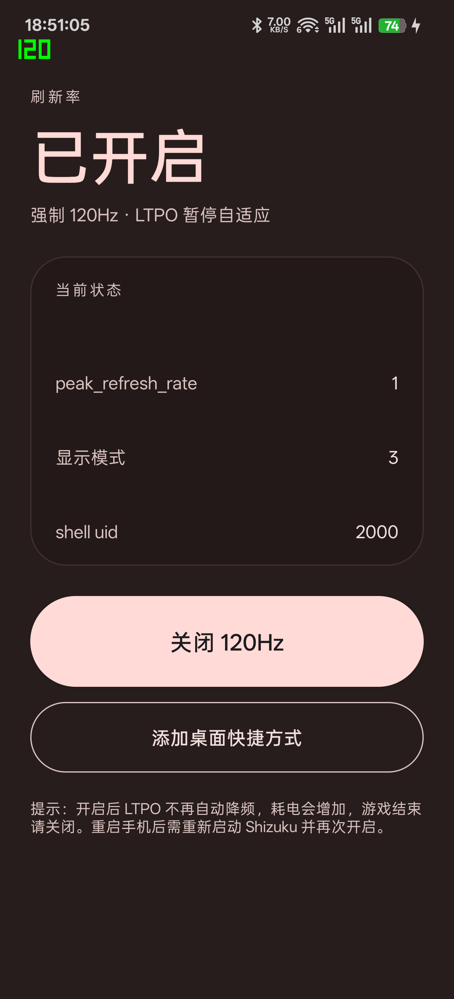
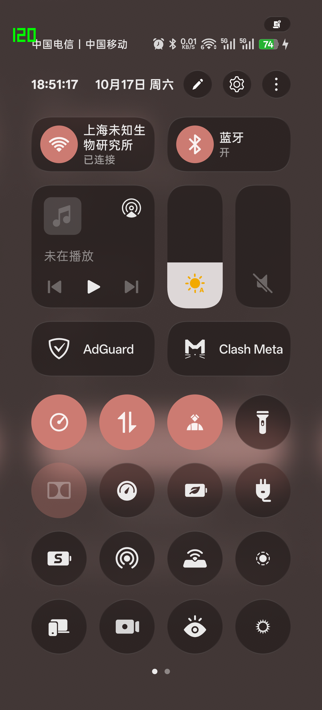

# 120Hz 开关（Hz120Switch）

给 ColorOS 用的手动高刷开关：**游戏前打开，游戏结束关闭。**

三种入口，随便挑：

- App 主界面的大按钮
- 桌面快捷方式（长按图标，或点「添加桌面快捷方式」固定到桌面）
- 下拉通知栏的快捷设置磁贴（和 WiFi / 蓝牙开关放在一起）

不需要 root，不需要解 BL，只需要手机上 **Shizuku 正在运行**。

| 主界面 | 快捷设置磁贴 |
|---|---|
|  |  |

---

## 为什么需要 Shizuku

在 PHY110 / ColorOS 16 / Android 16 上逐条实测的结论：

| 做法 | 结果 |
|---|---|
| 普通 App 写 `Settings.System.peak_refresh_rate` | ❌ `IllegalArgumentException: You cannot keep your settings in the secure settings.` |
| 绕道 `ContentResolver.insert` 直接写 provider | ❌ 同一个异常，provider 层就拦了 |
| 把 targetSdk 降到 22（provider 对旧应用只警告） | ⚠️ 能装（`adb install --bypass-low-target-sdk-block`），但每次启动都弹 `ReviewPermissionsActivity` |
| **Shizuku 以 shell（uid 2000）执行 `settings put`** | ✅ 面板从 60Hz 切到 120Hz |
| `cmd display set-user-preferred-display-mode` | ❌ `SecurityException: Package android does not belong to 2000` |
| `service call SurfaceFlinger` | ❌ `Operation not permitted`（SELinux 拒绝） |

还有一个关键细节：`peak_refresh_rate` 写 `120` 或 `120.0` 都没用，**必须写字符串 `1`** 才会切到 120Hz。

## 实测结果

| 操作 | `peak_refresh_rate` | `mActiveModeId` |
|---|---|---|
| 点「开启 120Hz」 | `1` | **3（120Hz）** |
| 点「关闭 120Hz」 | `null` | 2（回到 90Hz 自适应） |
| 桌面快捷方式 | 与按钮一致，可来回切换 | 同上 |
| 快捷设置磁贴 | 与按钮一致，磁贴状态同步 | 同上 |

主界面里的 `shell uid = 2000` 说明命令确实是以 Shizuku 的 shell 身份执行的。

---

## 安装

已经编译好的 APK：`build-manual/Hz120Switch.apk`

```powershell
adb install -r Hz120Switch.apk
```

debug 签名，包名 `com.dsh.hz120`。

## 使用

1. 确认 Shizuku 正在运行（无线调试或 root 启动）。
2. 打开 App，第一次会要求 Shizuku 授权，允许。
3. 三种入口任选：
   - 点主界面的大按钮；
   - 长按桌面图标 → 「切换 120Hz」；
   - 把快捷设置磁贴加到通知栏，点一下切换。
4. 「添加桌面快捷方式」按钮会请求固定一个桌面图标；ColorOS 桌面第一次可能要求「创建桌面快捷方式」权限，按提示去开启即可。

### 快捷设置磁贴

- 如果通知栏里没有，点快捷设置面板的编辑按钮，把「120Hz」拖进去。
- 磁贴会显示当前状态：`120Hz 已开启` / `120Hz 自适应`。

## 注意

- **重启手机后**：Shizuku 会停，系统也会把 `peak_refresh_rate` 改回 `120.0`。重新启动 Shizuku，再点一次开启即可。
- 开启后 LTPO 不再降到 1Hz，待机、刷视频都会更费电，机身也会更热。
- 游戏如果自己写死 60fps 渲染，面板 120Hz 也不会让游戏变 120 帧，只是不再掉档。
- ColorOS 后续 OTA 可能改变 `peak_refresh_rate = 1` 的语义，升级后要重测。
- App 不申请网络权限，不收集任何数据。

---

## 构建

### Android Studio

直接打开本目录。Gradle 会从 Maven Central 拉 `dev.rikka.shizuku:api/provider:13.1.5`。

### 命令行（不需要 Gradle）

```powershell
powershell -ExecutionPolicy Bypass -File .\build-manual.ps1
```

脚本会用 Android Studio 自带的 SDK（platform 37 / build-tools 36 / JBR）走
`aapt2 compile → aapt2 link → aidl → javac → d8 → zipalign → apksigner`。
首次运行会自动下载 Shizuku 的 AAR 到 `libs/`（已 gitignore）。

> 手工构建不会合并 AAR 的 manifest，所以主 manifest 里手工补了
> `moe.shizuku.manager.permission.API_V23` 和 `moe.shizuku.client.V3_SUPPORT`，
> 这两样缺一个 Shizuku 都连不上。
>
> 另外 Shizuku 的用户服务类必须**本身就是 `IBinder`**（这里直接
> `extends IUserService.Stub`），写成 `extends Service` 会在启动时抛
> `ClassCastException`。

## 目录

```
Hz120Switch/
├── app/src/main/
│   ├── AndroidManifest.xml
│   ├── aidl/com/dsh/hz120/IUserService.aidl
│   ├── java/com/dsh/hz120/
│   │   ├── MainActivity.java      # 主界面（Material You 风格）
│   │   ├── ToggleActivity.java    # 桌面快捷方式的隐形入口
│   │   ├── HzTileService.java     # 快捷设置磁贴
│   │   ├── Shell.java             # 共享的 Shizuku shell 通道
│   │   └── UserService.java       # 跑在 Shizuku 进程里的命令执行器
│   └── res/                       # 图标、字符串、快捷方式声明
├── build-manual.ps1               # 无 Gradle 构建脚本
└── README.md
```
